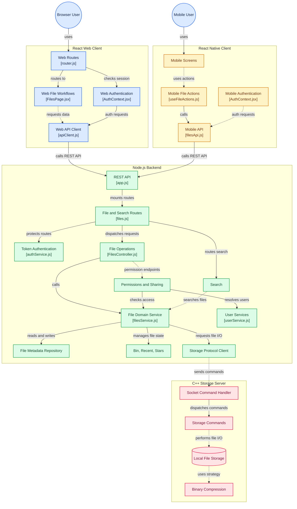

  

 

&nbsp;
&nbsp;
&nbsp;
&nbsp;

 

## Overview

Drive Me Nuts is a Google Drive-style storage system, built as a full-stack project in the Advanced Systems Programming course. Users register, organize files and folders, share them with other users through hierarchical permissions, search, star items and recover deleted ones from a bin. The same features are available in a React web client and a React Native mobile app, both running on one REST API.

The system was built in stages over the course: first the C++ storage server, then the Node.js backend and MongoDB, and finally the two clients.

<picture>
  <source media="(prefers-color-scheme: dark)" srcset="assets/facts-dark.svg">
  
</picture>

  

&nbsp;

 

## Architecture

<picture>
  <source media="(prefers-color-scheme: dark)" srcset="assets/architecture-dark.svg">
  
</picture>

The Node.js API handles everything the user interacts with: authentication with JSON Web Tokens, file and folder metadata, permissions, search, the bin and starred items, all stored in MongoDB. File contents go to a separate C++ storage server over a plain TCP socket. That server hands each connection to a fixed thread pool, executes GET, POST, DELETE and SEARCH commands, and stores files on disk with run-length encoding. One `docker-compose` file brings up the storage server, MongoDB, the API and the web client together.

 

## Inside the code

Module-level map of the repository, generated with <a href="https://gitdiagram.com/orbrener1/drive-part-5">GitDiagram</a>

 

Good starting points in the source:

| Layer | File |
|---|---|
| Web client routing | [`react-front/src/router.js`](https://github.com/OrBrener1/Drive-part-5/blob/main/react-front/src/router.js) |
| Mobile file actions | [`react-native-app/src/hooks/useFileActions.js`](https://github.com/OrBrener1/Drive-part-5/blob/main/react-native-app/src/hooks/useFileActions.js) |
| REST API entry point | [`NodeJS-server/src/app.js`](https://github.com/OrBrener1/Drive-part-5/blob/main/NodeJS-server/src/app.js) |
| File domain logic | [`NodeJS-server/src/services/filesService.js`](https://github.com/OrBrener1/Drive-part-5/blob/main/NodeJS-server/src/services/filesService.js) |
| Link to the C++ server | [`NodeJS-server/src/services/cppClientService.js`](https://github.com/OrBrener1/Drive-part-5/blob/main/NodeJS-server/src/services/cppClientService.js) |
| C++ server and thread pool | [`cpp-server/src/server/`](https://github.com/OrBrener1/Drive-part-5/tree/main/cpp-server/src/server) |

 

## Design decisions

- Permissions are hierarchical: sharing a folder gives the same access to everything inside it. Starring is personal and applies to a single item, so one user's organization never changes what another user sees.
- Only the owner can delete an item for everyone. When a user it was shared with deletes it, the item leaves that user's workspace and their permission is revoked, while the owner and the other users keep it.
- Moving a folder to the bin hides its whole subtree from the file views and from search until the folder is restored.

 

## Stack

**Server side** · C++ · Node.js · Express · MongoDB (Mongoose) · JSON Web Tokens 
**Clients** · React · React Native (Expo) 
**Infrastructure** · Docker · Docker Compose
