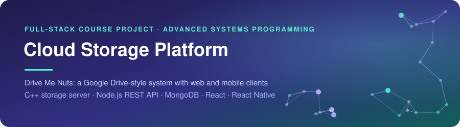
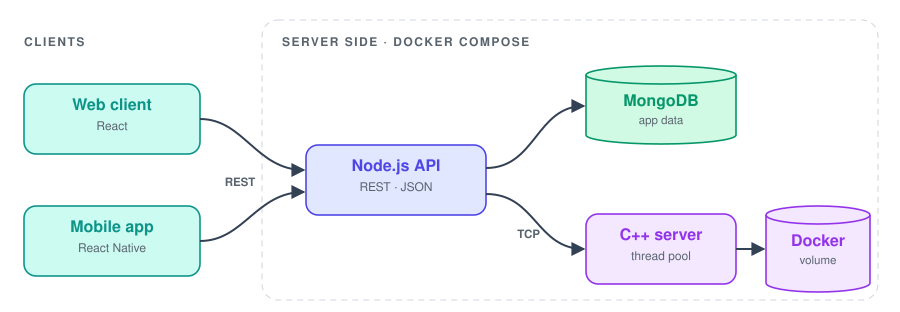
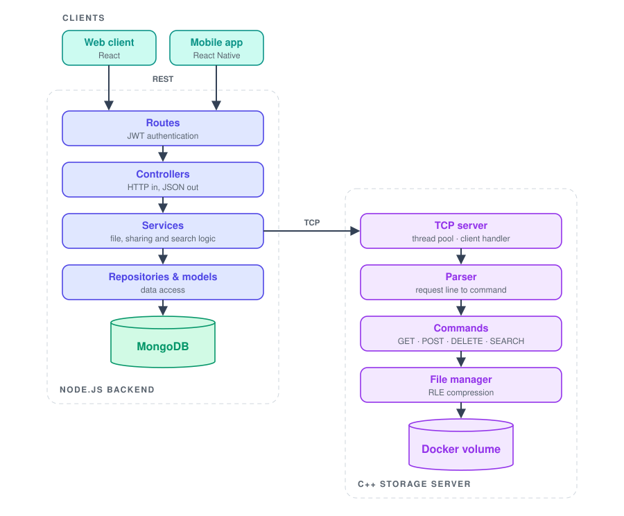

  

 

&nbsp;
&nbsp;
&nbsp;
&nbsp;

 

## Overview

Drive Me Nuts is a Google Drive-style storage system, built as a full-stack project in the Advanced Systems Programming course. Users register, organize files and folders, share them with other users through hierarchical permissions, search, star items and recover deleted ones from a bin. The same features are available in a React web client and a React Native mobile app, both running on one REST API.

The system was built in stages over the course: first the C++ storage server, then the Node.js backend and MongoDB, and finally the two clients.

&nbsp;

 

## Architecture

<picture>
  <source media="(prefers-color-scheme: dark)" srcset="assets/architecture-dark.svg">
  
</picture>

The Node.js API handles everything the user interacts with: authentication with JSON Web Tokens, file and folder metadata, permissions, search, the bin and starred items, all stored in MongoDB. File contents go to a separate C++ storage server over a plain TCP socket. That server hands each connection to a fixed thread pool, executes GET, POST, DELETE and SEARCH commands, and stores files, run-length encoded, in a Docker volume. One `docker-compose` file brings up the storage server, MongoDB, the API and the web client together.

 

## How it's built

Each service is split into layers that each do one job. In the Node.js backend a request passes from the routes, where its JWT is checked, to a controller, then to a service that holds the file, sharing and search logic, and finally to a repository that reads and writes MongoDB. HTTP handling, business rules and data access stay apart, in the spirit of MVC. The C++ server is layered the same way: the TCP server hands each connection to a thread pool, a parser turns the request into a command, and each command works through a file manager that compresses what it stores in a Docker volume.

<picture>
  <source media="(prefers-color-scheme: dark)" srcset="assets/modules-dark.svg">
  
</picture>

We designed the code to stay maintainable as it grew over the course's stages. The object-oriented C++ server follows SOLID: every command, connection, parser, file manager and compression method sits behind its own interface, so new commands or storage strategies plug in without rewriting the code around them. Across the project we kept to KISS, DRY and separation of concerns, with loosely coupled services that talk only through the REST API and the TCP protocol.

 

## Design decisions

- Permissions are hierarchical: sharing a folder gives the same access to everything inside it. Starring is personal and applies to a single item, so one user's organization never changes what another user sees.
- Only the owner can delete an item for everyone. When a user it was shared with deletes it, the item leaves that user's workspace and their permission is revoked, while the owner and the other users keep it.
- Moving a folder to the bin hides its whole subtree from the file views and from search until the folder is restored.

 

## Stack

**Server side** · C++ · Node.js · Express · MongoDB (Mongoose) · JSON Web Tokens 
**Clients** · React · React Native (Expo) 
**Infrastructure** · Docker · Docker Compose

 

> [!NOTE]
> Security was outside the scope of the course, so the system was not hardened for real-world use. Requests are authenticated with JWTs, but data protection beyond that, such as encrypted transport and secure password storage, was not implemented.
